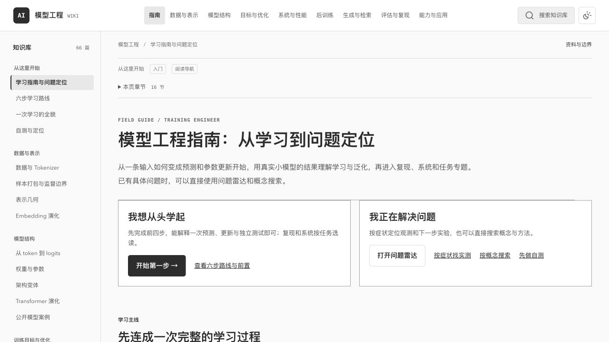

# 模型工程 Wiki

一个中文交互式知识库，帮助你从一次预测和参数更新出发，理解模型如何训练、泛化、推理与复现。
面向想系统补齐原理和工程判断的学习者，以及需要按症状定位问题的模型工程师。

目前包含 **66 个页面、六步学习主线和 13 组已登记的实测来源**，结合可交互的计算演示、
真实小模型与检索实验，以及固定版本的一手技术资料。既能顺着路线学习，也能搜索具体问题查阅。



[快速开始](#快速开始) · [怎么读](#怎么读) · [内容范围](#内容范围) · [实验与核验](#实验与核验) · [开发与文档](#开发与文档)

## 快速开始

最近核验的基础环境：**Node.js 24.13.0、Python 3.14.2**。Node 用于构建，Python 3 用于本地预览。
PyTorch、Faiss 等实验依赖按需安装，阅读网页无需准备这些环境。

```bash
git clone https://github.com/glenzli/ai-stuffs.git
cd ai-stuffs
npm ci
npm run build
npm run serve
```

打开 **[模型工程指南](http://127.0.0.1:4173/training-engineer-guide.html)**。
本地服务默认监听 `127.0.0.1:4173`，在终端按 `Ctrl+C` 停止。

页面由静态文件组成，公式在构建时排版，搜索与交互在浏览器本地运行。构建后的站点可以直接使用
`dist/` 部署到静态文件服务；网页运行时无需模型服务或外部 CDN。

## 怎么读

下面的网页链接在启动本地服务后使用。

| 你想做什么 | 从这里开始 |
| --- | --- |
| 建立整体认识，再按自己的问题深入 | [模型工程指南](http://127.0.0.1:4173/training-engineer-guide.html) |
| 从头走完一次学习过程 | [六步学习路线](http://127.0.0.1:4173/deep-dive.html) |
| 排查 loss、显存、吞吐或恢复问题 | [问题雷达](http://127.0.0.1:4173/training-engineer-guide.html#radar-title) |
| 找原始报告、源码、输入与重跑条件 | [实测导航](http://127.0.0.1:4173/deep-dive.html#verified-experiments) |
| 检查自己是否能算清关键工程口径 | [综合自测](http://127.0.0.1:4173/engineering-check.html) |

学习主线是：**输入与监督 → 模型前向 → 损失与更新 → 学习与泛化 → 稳定与复现 → 系统与扩展**。
前四步形成最小学习闭环；之后按任务选择后训练、生成检索或能力应用。每步都有前置、自检和选读，
不需要一次读完全部页面。

## 内容范围

| 方向 | 主要内容 |
| --- | --- |
| 数据与表示 | Tokenizer、监督边界、样本打包、Embedding 与表示几何 |
| 模型结构 | Transformer 计算图、权重与参数量、MoE、GDN/KDA、AttnRes 与 Gated Attention |
| 训练与优化 | 目标函数、完整反传、优化器、初始化、Batch 噪声、混合精度与 WSD/checkpoint 平均 |
| 系统与性能 | 分布式通信、上下文并行、激活重算、Attention/输出层分块与完整 step 计量 |
| 微调与后训练 | SFT、LoRA、DPO、RL、自反馈、采样分布校正、蒸馏与验证器 |
| 推理与检索 | 位置与 KV Cache、解码、量化、投机解码/MTP、BM25、向量检索、Faiss 与过滤 |
| 评估与复现 | 配对统计、校准、能力回归、checkpoint、随机状态、故障回放与第一处差异 |
| 能力与应用 | 推理计算、多模态、工具、Agent、上下文学习与训练环境 |

近期公司公开技术沿已有专题组织，标明一手来源、指定版本与披露边界。
可从[训练技术说明](docs/training-techniques-2026-10-30.md)和[机制核验目录](docs/reproducing-experiments.md#已归档的训练机制核验)查看依据。

## 实验与核验

页面里的内容分为三类，各自有明确的结论范围：

- **计算演示**：小维度、固定输入、可交互或离线重算，用来理解公式与工程口径。
- **真实实测**：实际运行的小模型、自动微分、恢复、CPU 通信或检索实验，提供报告、源码、输入与工件。
- **论文与模型资料**：按指定版本解释公开方法；本地算例的通过不代表复现了作者的完整模型或性能。

现有实战覆盖中文语料到小模型训练、长度泛化失败诊断、复现差异定位、完整训练 step 对照、
真实中文检索，以及梯度累积、来源过滤和完整模型缓存续算。报告保留原始预测、误差与失败边界。
大部分训练与性能结果来自 CPU；耗时和保存张量引用量不直接等同 GPU 吞吐或显存峰值。

### 不训练模型，先检查与重算

```bash
# 核对源码、页面映射和实验来源，生成网页
npm run check

# 核对登记的报告、下载包、哈希与来源关系
npm run test:provenance

# 一份只用 Python 标准库的机制核验：输出门、17 项导数和 KV 反例
python3 artifacts/gated-attention-20261030T125431Z/check-mechanisms.py
```

`src/experiment-sources.json` 登记当前 13 组实测来源。页面提供原始报告、源码与工件包、
SHA-256 校验及独立重跑条件；构建会在来源缺失或校验不符时停止。

### 选择一组实验重跑

先按[实验复现指南](docs/reproducing-experiments.md)准备该组固定环境，再执行预检，例如：

```bash
npm run check:experiment -- --only padding-inference --out-dir artifacts/padding-my-run
```

预检不启动训练或下载模型。真正重跑会写入新目录，生成报告与 `candidate.json`；
核对后再用 `accept:experiment` 显式采纳，页面默认值和来源清单才会更新。
完整命令、环境、恢复方式和各实验的边界都放在复现指南中。

## 开发与文档

项目使用 ES modules 和轻量静态生成脚本；KaTeX 负责构建期公式排版，parse5 负责 HTML 解析。
页面正文、元数据、主题导航、交互与样式分别维护。

```text
src/content/                 页面正文
src/scripts/features/        浏览器交互与计算
src/styles/                  主题、组件与响应式样式
src/layouts/                 共享页面布局
src/{pages,wiki,learning}.mjs 页面配置、主题归属与学习顺序
src/{references,search}.mjs   资料边界与搜索元数据
scripts/                     构建、检查、实验 runner 与来源采纳
artifacts/                   已保留的实验来源、结果与核验记录
docs/                        开发、复现与分轮验收说明
dist/                        生成的网站
```

正文从 `src/content/<slug>.html` 编辑；新增页面要同步页面配置、主题归属、搜索与资料边界。
修改后执行 `npm run check` 并按影响范围选择检查。`dist/` 是生成结果，不直接编辑。

| 文档 | 用途 |
| --- | --- |
| [开发与内容维护](docs/development.md) | 源码结构、页面地图、配色、公式、编辑约定与检查选择 |
| [实验复现指南](docs/reproducing-experiments.md) | Node/Python 环境、各组重跑命令、候选采纳与完整来源 |
| [复现前检查](docs/experiment-preflight-2026-10-29.md) | 前置依赖、输入身份、目录冲突、退出码与限制 |
| [实测导航核验](docs/experiment-navigation-2026-10-29.md) | 页面入口与独立重跑说明的对应关系 |
| [知识正确性复核](docs/knowledge-review-2026-10-29.md) | 数学前提、公式条件和工程表述的审查记录 |

共享组件采用黑白灰阅读主题，蓝、紫、橙等颜色只辅助表达比较、差异和状态，并保留文字或数值。
`.gitignore` 排除依赖、虚拟环境、构建结果和临时输出；已登记的完整实验来源通过明确清单保留。

## 常见问题

- **打开后不是总指南？** `/` 对应第一步学习页；总入口是 `/training-engineer-guide.html`。
- **修改后页面没有更新？** 重新构建并刷新浏览器；本地预览命令不监听源码变化。
- **4173 端口已占用？** 可以运行 `python3 -m http.server 4174 --bind 127.0.0.1 --directory dist`，并把访问地址改为 4174。
- **构建提示缺少实验来源？** 保留仓库跟踪的工件与目录层级，按错误中的路径、哈希和复现指南核对；新结果通过候选采纳，不直接覆盖旧记录。

## 许可

仓库目前未设置项目级 `LICENSE`。第三方 Lucide 图标许可见 [lucide-LICENSE.txt](src/assets/lucide-LICENSE.txt)。
